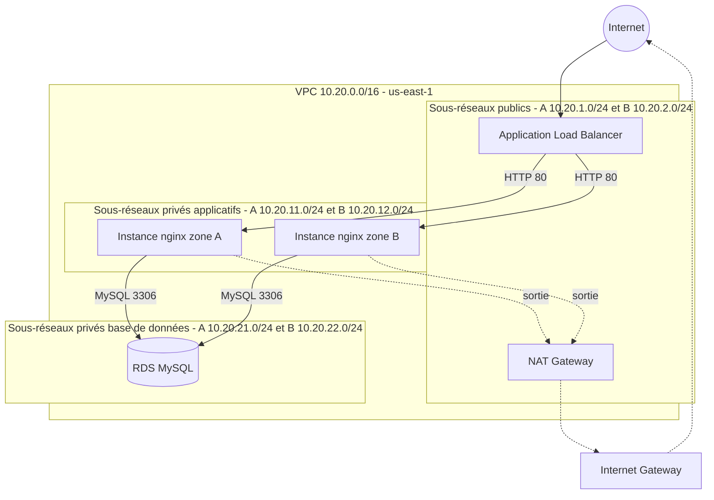

# Architecture

## Schéma

## Flux de déploiement

Développeurs -> Dépôt Git -> Pipeline GitHub Actions -> Terraform -> AWS (réseau, Load Balancer, Auto Scaling, base de données, stockage).

## Composants

| Composant | Détail |
|---|---|
| VPC | 10.20.0.0/16 sur deux zones de disponibilité |
| Sous-réseaux publics | Load Balancer et NAT Gateway |
| Sous-réseaux privés applicatifs | Instances de l'Auto Scaling Group, sortie via la NAT Gateway |
| Sous-réseaux privés base de données | RDS, aucune route vers Internet |
| Application Load Balancer | Listener HTTP 80, health check sur `/` |
| Auto Scaling Group | 2 à 4 instances, politique de suivi du CPU (cible 60 %) |
| RDS MySQL | Non public, chiffré, mot de passe géré par Secrets Manager |
| S3 | Bucket d'état Terraform et bucket de ressources et journaux |
